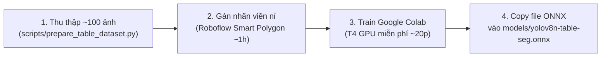

# Hướng Dẫn Tự Huấn Luyện & Tích Hợp YOLOv8-seg Cho Bàn Bi-a

Tài liệu này hướng dẫn quy trình huấn luyện mô hình phân đoạn **YOLOv8-seg** siêu nhẹ (~100 ảnh) để tự động phát hiện mặt nỉ bàn bi-a với độ chính xác cao nhất mà không tốn chi phí.

---

## 1. Quy trình tổng quan 3 bước



---

## 2. Bước 1: Thu thập ảnh từ video quán bi-a

Chạy lệnh trích xuất tự động 100 frame đa dạng từ các video quay quán bi-a:

```powershell
.\.venv\Scripts\python scripts/prepare_table_dataset.py --videos data/recordings --target 100
```

Ảnh sẽ được lưu vào:
- `data/datasets/table_seg/images/train/` (khoảng 80 ảnh)
- `data/datasets/table_seg/images/val/` (khoảng 20 ảnh)

---

## 3. Bước 2: Gán nhãn cực nhanh bằng Roboflow (Miễn phí)

1. Truy cập [Roboflow](https://roboflow.com) và tạo một dự án miễn phí:
   - **Project Type:** Chọn `Instance Segmentation`.
2. Kéo thả toàn bộ ảnh từ thư mục `data/datasets/table_seg/images/` lên Roboflow.
3. **Gán nhãn bằng tính năng Smart Polygon (tích hợp SAM):**
   - Click chuột vào giữa mặt nỉ bàn bi-a, Roboflow sẽ tự động vẽ viền khép kín toàn bộ mặt nỉ.
   - Đặt tên nhãn là: `table_felt`.
   - Thời gian hoàn thành: Chỉ mất khoảng 5–10 giây cho mỗi bức ảnh (tổng cộng ~1 tiếng cho 100 ảnh).
4. Bấm **Generate Dataset** -> Chọn **Export** định dạng `YOLOv8 PyTorch`.

---

## 4. Huấn luyện trên Google Colab (GPU T4 miễn phí — Khuyên dùng)

> **Dataset khuyến nghị (v2 tổng hợp 450 ảnh):** Dùng file [smartbilliard_table_seg_v2.zip](file:///d:/SmartBilliard/data/datasets/smartbilliard_table_seg_v2.zip) đã gộp chuẩn 1 lớp `0: table_felt`:
> - **364 ảnh `billiard-7sno1` v9** (CC BY 4.0, ảnh gốc chưa bị ép méo)
> - **30 ảnh camera thực tế của quán** đã kiểm tra & gán nhãn thủ công (`22 ảnh train × 3` + `4 valid` + `4 test`, tách theo thứ tự thời gian cuối video)
> - **12 ảnh nền trống không có bàn** từ `people_test.mp4` (`10 train / 1 valid / 1 test`, file nhãn rỗng) giúp giảm dự đoán nhầm
> - Tổng cộng: **`333 train` / `76 valid` / `41 test` (`450 ảnh`)**

Mở một cuốn sổ tay mới trên [Google Colab](https://colab.research.google.com), chọn **Runtime -> Change runtime type -> T4 GPU**, tải file `smartbilliard_table_seg_v2.zip` lên Colab rồi chạy đoạn mã sau:

```python
# 1. Cài đặt thư viện
!pip install ultralytics

# 2. Giải nén bộ dữ liệu tổng hợp v2 (450 ảnh, đơn lớp table_felt)
!unzip -q -o smartbilliard_table_seg_v2.zip -d /content/dataset

# 3. Tự động gắn đường dẫn tuyệt đối trong /content/dataset/data.yaml
import yaml
with open("/content/dataset/data.yaml", "r") as f:
    cfg = yaml.safe_load(f)
cfg["path"] = "/content/dataset"
with open("/content/dataset/data.yaml", "w") as f:
    yaml.safe_dump(cfg, f)

# 4. Huấn luyện mô hình YOLOv8n-seg (tối ưu cho cả bàn nhỏ ở góc camera rộng)
from ultralytics import YOLO

model = YOLO("yolov8n-seg.pt")
results = model.train(
    data="/content/dataset/data.yaml",
    epochs=80,
    patience=25,
    imgsz=640,
    batch=8,
    augment=True,
    mosaic=1.0,
    close_mosaic=15,
    scale=0.5,
    degrees=8.0,
    perspective=0.0005,
    hsv_h=0.03,
    hsv_s=0.25,
    hsv_v=0.35,
    project="runs/table_seg",
    name="yolov8n_table"
)

# 5. Xuất sang định dạng ONNX cho OpenCV DNN của SmartBilliard
exported = model.export(format="onnx", imgsz=640, simplify=True, opset=12)
print("Xuất thành công:", exported)

# 6. Tải file best.onnx về máy
from google.colab import files
files.download(exported)
```

Quá trình huấn luyện chỉ mất khoảng **12 – 18 phút**. Sau khi tải về, đổi tên file thành `yolov8n-table-seg.onnx` và chép vào `d:\SmartBilliard\models\`.

---

## 5. Bước 4: Tích hợp vào SmartBilliard

1. Đổi tên file `best.onnx` thành:
   ```
   models/yolov8n-table-seg.onnx
   ```
2. Đặt file vào thư mục `d:\SmartBilliard\models\yolov8n-table-seg.onnx`.
3. Mở giao diện Web SmartBilliard -> Vào **Hiệu chuẩn ROI** -> Bấm nút **"🪄 Tự động dò bàn"**.
4. Hệ thống sẽ tự động phát hiện file ONNX và chuyển sang chế độ:
   `"Đã tự động phát hiện bàn bi-a từ camera (Phương pháp: YOLOv8-seg (Deep Learning))"`.

---

## 6. Cơ chế Lazy-Loading bảo toàn hiệu năng

- File `models/yolov8n-table-seg.onnx` chỉ nặng **~6.7 MB**.
- Mô hình **không bao giờ chiếm RAM thường trực**: Chỉ khi người dùng bấm nút dò bàn trên web, API mới nạp model vào RAM trong 0.1 giây, quét đúng 1 frame, rồi giải phóng ngay lập tức.
- Giữ trọn 100% tài nguyên CPU/GPU cho việc nhận diện người chơi và tính tiền.
