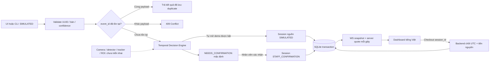

# Luồng dữ liệu

Server gắn timestamp nhận cho tín hiệu mô phỏng. UUID lặp cùng payload trả kết quả cũ, không chạy FSM lại. Candidate chỉ đủ khi nhận chuỗi tín hiệu theo thời gian thật; timeout/gap phá chuỗi. Tín hiệu vắng hoặc mơ hồ không mở bàn và không đóng phiên.

Snapshot có `server_time`, tables/session/quotes, config, nguồn và 30 events mới nhất. Lịch sử session lấy riêng bằng REST có limit/offset. Client không tính tiền và không tự mở phiên khi reload/reconnect.

Sơ đồ tương lai không có nghĩa đã nối camera. Dữ liệu khung hình sẽ chỉ ở memory trừ khi có đồng ý thu dataset.
