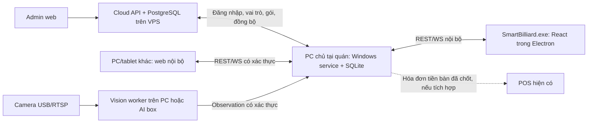

# Đề xuất kiến trúc sản phẩm SmartBilliard cài trên PC

Ngày: 18/11/2026. Đây là **thiết kế đề xuất**, chưa phải các tính năng đã có trong code. Mục tiêu: người dùng tải một bộ cài `.exe`, đăng nhập bằng tài khoản admin tạo, quản lý bàn theo vai trò; gói AI có xử lý camera để đề xuất/tự mở bàn sau khi được kiểm chứng.

## Quyết định ngắn gọn

| Câu hỏi | Đề xuất |
| --- | --- |
| Tạo bộ cài Windows bằng gì? | **Electron + React** cho cửa sổ desktop; **FastAPI/Python** hiện có đóng gói thành service bằng **PyInstaller**; **electron-builder/NSIS** tạo installer `.exe`. React build được phục vụ tại `127.0.0.1` bởi backend. Có thể thay Electron bằng Tauri sau nếu kích thước bộ cài là ưu tiên cao và chấp nhận thêm Rust/integration effort. |
| Database lưu ở đâu? | **PostgreSQL trên VPS/managed cloud** cho tài khoản, quán, vai trò, gói, thiết bị và audit quản trị. **SQLite trên một máy chủ vận hành của mỗi quán** cho bàn, phiên chơi, giá đã chốt, sự kiện camera và hàng đợi đồng bộ. Không tạo một SQLite độc lập trên từng PC thu ngân. |
| Có cần VPS không? | **Có**, nếu muốn admin cấp tài khoản/gói từ xa, đăng nhập và kiểm soát thuê bao tập trung. VPS chỉ là control plane; luồng camera và tính tiền mỗi quán có thể chạy nội bộ/offline. Pilot có thể đặt API và PostgreSQL trên một VPS với TLS và backup; quy mô lớn mới tách dịch vụ. |
| AI box làm gì? | Nhận USB/RTSP, chạy detector → tracker → gán bàn/ROI, gửi **observation có xác thực** qua LAN đến backend của quán. Không thay POS, không tự cấp license, không quyết định giá hay số tiền. Nếu PC chạy đủ tốt thì chưa cần box riêng. |
| POS/web/app? | `.exe` là vỏ desktop cho web React; web cũng có thể dùng trên terminal khác sau khi bảo mật LAN. POS thanh toán/tồn kho là tích hợp tùy quán ở giai đoạn sau. Chưa cần app điện thoại native. |

## Sơ đồ triển khai đề xuất

**PC chủ** là máy duy nhất của quán ghi SQLite và là nguồn chính thức của thời gian, giá, số tiền, trạng thái bàn. Nếu chỉ một PC, cửa sổ desktop và service ở cùng máy. Nếu nhiều PC, các máy còn lại là client, không có database riêng. PC chủ phải còn bật khi quán đang vận hành; với nhiều terminal/nhu cầu 24/7, chuyển vai trò này sang mini PC/server nội bộ luôn bật. Cloud lưu tenant/account/entitlement; lưu bản sao/tổng hợp nghiệp vụ chỉ khi đã thiết kế đồng bộ và chính sách dữ liệu. Không cần đẩy video người chơi lên VPS.

## Hai loại quyền cần tách

1. **Vai trò người dùng (RBAC)**: admin hệ thống tạo quán/chủ quán; chủ quán tạo hoặc được admin cấp tài khoản quản lý/nhân viên. Ví dụ: chủ quán quản lý giá, nhân viên mở bàn và checkout, người xem chỉ đọc. Backend kiểm tra quyền trên từng endpoint, không chỉ ẩn nút ở React. Tài khoản cần gắn `tenant_id`/`store_id`; mọi truy vấn phải cô lập quán.
2. **Quyền gói (entitlements)**: gói `BASIC` cho quản lý bàn, lịch sử, tính tiền; gói `AI` thêm cấu hình camera/ROI, observation và tính năng AI. Gói áp cho quán/tài khoản thuê bao, không áp thay vai trò. Một nhân viên của quán gói AI vẫn không được đổi giá nếu vai trò không cho phép.

Cloud giữ thông tin gói và phát entitlement có chữ ký, thời hạn, `tenant_id`, thiết bị và danh sách tính năng. Backend quán kiểm tra entitlement khi thực thi API AI; AI box nhận credential thiết bị riêng, không dùng mật khẩu nhân viên. Thiết kế trước chính sách mất Internet: phiên đã mở và checkout cục bộ vẫn hoạt động, entitlement cache chỉ có hiệu lực trong một thời gian giới hạn đã công bố; quyền bị thu hồi trên cloud sẽ có độ trễ đến lần đồng bộ tiếp theo. Không giấu tính năng ở frontend rồi coi đó là bảo vệ gói.

Admin tạo tài khoản bằng lời mời hoặc mật khẩu tạm cần đổi khi đăng nhập đầu; mật khẩu được băm ở server, kết nối HTTPS, access token ngắn hạn và refresh được bảo vệ. Không nhúng khóa ký, mật khẩu DB hay thông tin quản trị vào `.exe`/`.env` phát cho khách. Secret cục bộ nên lưu bằng Windows Credential Manager/DPAPI. Cần audit thao tác đổi giá, mở/đóng phiên, checkout, đổi gói và thiết bị.

## Bộ cài `.exe` thực tế gồm gì?

1. Build React hiện có thành static assets; thêm Electron main process tạo cửa sổ trỏ về service cục bộ. Không cần chạy Vite/Node development server trên máy khách.
2. Đóng gói FastAPI/Python và dependencies bằng PyInstaller kiểu folder nội bộ; dùng installer NSIS của electron-builder để cài vỏ Electron, service, assets và cấu hình. `.exe` tải về là **installer**; ứng dụng sau cài có shortcut và tự khởi động service theo chính sách.
3. Cài binary trong `Program Files`, còn SQLite/config/logs ở `ProgramData/SmartBilliard` hoặc thư mục dữ liệu phù hợp. Update không ghi đè DB. Dùng migration có backup, health check và rollback; sao lưu SQLite bằng cơ chế an toàn khi đang chạy hoặc dừng service trước khi copy.
4. Ký số installer/binary khi phát hành rộng để giảm cảnh báo Windows SmartScreen. Chỉ phát hành update đã ký; không cho client tự chạy mã tải từ server.

PyInstaller tạo executable Python, **không tự biến hệ thống thành bộ cài hoàn chỉnh**. Electron-builder/NSIS lo installer. Tauri có thể cho vỏ nhẹ hơn nhưng vẫn cần đóng gói và quản lý Python sidecar/service; vì repository đã là React + FastAPI, Electron là đường ngắn hơn cho phiên bản đầu.

## AI box và điều kiện bật tự mở bàn

Gói AI cấp quyền sử dụng tính năng, nhưng AI box là **năng lực tính toán vật lý**. Camera có thể cắm vào PC chủ hoặc vào box cùng LAN. Box đọc RTSP, inference, tracking, ROI và gửi event nhỏ; backend quán thực hiện FSM, chống trùng, lưu phiên và tính tiền. Một box/camera không tự chứng minh bao phủ 4–8 bàn. Code đang thử YOLOv8n person/pose và model cue riêng qua OpenCV DNN, ưu tiên CUDA FP16 khi bản OpenCV hỗ trợ rồi fallback CPU; repository vẫn thiếu các file weights và chưa có benchmark video thật. Trên Jetson phải xác nhận bản OpenCV có CUDA DNN và kết quả thực; nếu không đạt, thêm backend TensorRT rồi đánh giá lại.

Triển khai AI theo thứ tự: quan sát camera thật → hiển thị đề xuất mở bàn cho nhân viên xác nhận → đo false/missed opening theo quán/bàn → chỉ sau khi đạt tiêu chí đã chốt mới cho phép tự mở bằng tùy chọn riêng của quán. Mất người/gậy không tự đóng phiên. Thiếu weights, camera lỗi, event quá cũ hoặc entitlement hết hạn phải báo trạng thái rõ và không tự mở.

## VPS: phạm vi tối thiểu và mở rộng

- Pilot: domain + HTTPS, cloud FastAPI, PostgreSQL, admin web, backup tự động và giám sát tối thiểu. Chưa cần Kubernetes, broker hay nhiều VPS. Không đưa RTSP hoặc stream MJPEG lên Internet.
- Khi cần nhiều quán: mỗi request cloud có tenant isolation; device registration, audit, rate limit, migration và kiểm tra restore backup. Tách DB/managed PostgreSQL và worker đồng bộ khi tải thực tế yêu cầu. Chưa thể chốt CPU/RAM VPS khi không có số quán/người dùng/tần suất đồng bộ.
- Nếu không muốn VPS: chỉ có phương án cấp tài khoản/license cục bộ bằng tay hoặc server tại mỗi quán; khó quản lý thuê bao, thu hồi quyền và đăng nhập xuyên địa điểm. Điều này không phù hợp mục tiêu admin tập trung đã nêu.

## Khoảng cách từ code hiện tại

Repository hiện là một FastAPI process + SQLite + React build, chủ yếu theo mô hình local. Chưa có Electron/installer, cloud auth/admin, RBAC, gói thuê bao, PostgreSQL, sync, Windows service, migration sản phẩm hay bảo mật LAN. `apps/api/main.py` chỉ chấp nhận localhost/Origin local; các endpoint ingestion/camera chưa có auth. `services/vision/detector.py` thử CUDA FP16 nếu bản OpenCV hỗ trợ, sau đó fallback CPU; khi thiếu model sẽ không có suy luận. Những việc này là backlog triển khai mới, không nên quảng bá là đã hoàn thành. Kế hoạch benchmark và mock hai gói xem [MODEL_AND_PRODUCT_MVP_PLAN](../planning/MODEL_AND_PRODUCT_MVP_PLAN.md).

**Thứ tự đề nghị:** (1) thiết kế tenant/user/role/plan và cloud API; (2) đóng gói Basic chạy một PC, login + backend local + SQLite + installer; (3) backup/migration và quyền endpoint; (4) ghép AI worker + chứng minh camera thật; (5) đa terminal/LAN và tích hợp POS theo quán. Bài test cho auth/tenant isolation, billing/FSM/idempotency, cập nhật phiên bản và mất mạng là bắt buộc trước khi giao khách hàng.
