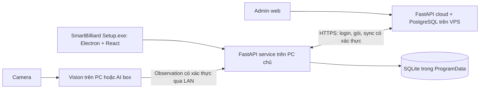

# Kế hoạch chọn model và MVP desktop hai gói

Ngày lập: 18/11/2026. Trạng thái: **kế hoạch**, chưa có kết quả benchmark hoặc sản phẩm `.exe` hoàn chỉnh. Phạm vi đầu: Windows, một quán, một PC chủ, một camera; 3–4 bàn là giả thuyết cần kiểm chứng bằng cảnh thật. Không dùng dữ liệu mô phỏng để tuyên bố nhận diện AI.

## 1. Quyết định cần đạt

1. Chọn **pipeline phù hợp cho quyết định mở bàn**, không chỉ model có mAP cao nhất: person/pose → tracking → ROI → temporal FSM → gợi ý mở bàn. Cần model cue riêng nếu chính sách đòi gậy; COCO pretrained không chứng minh phát hiện gậy.
2. Chọn runtime và cấu hình chạy được trên Acer Nitro 5 i5-12500H, RAM 16 GB, RTX 3050 Ti Laptop GPU 4 GB; từ đó có baseline để so với AI box. Bản OpenCV trong `.venv` đã được kiểm tra: không thấy CUDA (`cv2.cuda.getCudaEnabledDeviceCount() = 0`), nên phép đo hiện tại sẽ là CPU cho đến khi có runtime GPU đã xác minh.
3. Tạo **một** sản phẩm với hai entitlement `BASIC` và `AI`, kiểm soát cùng với vai trò nhân viên ở backend; đóng gói thành installer `.exe`, admin cấp tài khoản/gói qua cloud.

## 2. Khảo sát model trên web: shortlist, chưa chọn thắng cuộc

| Ứng viên | Vai trò trong phép thử | Lợi thế | Việc cần kiểm chứng |
| --- | --- | --- | --- |
| `yolov8n` / `yolov8n-pose` | Baseline theo code hiện có | Pipeline và parser đã hướng tới YOLOv8; [Ultralytics hỗ trợ detect/pose/export](https://docs.ultralytics.com/models/yolov8). | Weights, output shape, GPU runtime, khả năng thấy người/khớp chân ở xa. |
| `yolo11n` / `yolo11n-pose` | Challenger cùng họ công cụ | [Ultralytics hỗ trợ detect/pose/export](https://docs.ultralytics.com/models/yolo11). | Viết adapter output đúng; so trên đúng clip và runtime. |
| `yolo26n` / `yolo26n-pose` | Challenger mới hơn, ưu tiên đo CPU | [Ultralytics hỗ trợ detect/pose/export](https://docs.ultralytics.com/models/yolo26). Output NMS-free/end-to-end có thể khác YOLOv8; [tài liệu ONNX export](https://docs.ultralytics.com/integrations/onnx). | Không được thay file model vào parser YOLOv8 và giả định output giống nhau; cần adapter, so accuracy sau export. |
| `YOLOX-Nano` | Phương án dự phòng person-only khi licensing/tích hợp Ultralytics là trở ngại | [Mã nguồn YOLOX dùng Apache-2.0](https://github.com/Megvii-BaseDetection/YOLOX/blob/main/LICENSE), có ONNX. | Không có pose cùng cấu hình; phải xác minh riêng quyền dùng weights và chi phí tích hợp. Không so số COCO khác input như thể cùng bài toán. |

Theo bảng **detect COCO ở 640 px do nhà phát triển công bố**, mAP50-95 của YOLOv8n/YOLO11n/YOLO26n lần lượt là **37,3 / 39,5 / 40,9**. Đây là độ đo COCO cho detect, **không phải** độ chính xác SmartBilliard, pose, cue hoặc tỷ lệ mở bàn đúng. Thời gian suy luận công bố cũng dùng cấu hình/hardware khác laptop này. [YOLOv8](https://docs.ultralytics.com/models/yolov8), [YOLO11](https://docs.ultralytics.com/models/yolo11), [YOLO26](https://docs.ultralytics.com/models/yolo26).

**Chiến lược thử:** vòng 1 so ba detect-n trên cùng dữ liệu để xem person/foot anchor; vòng 2 so pose-n của hai ứng viên tốt nhất nếu pose cải thiện gán bàn/che khuất; vòng 3 fine-tune cue detector nhỏ trên cùng tập nhãn, chỉ sau khi có dataset cue. Nếu n không đủ chi tiết ở bàn xa, thử một bản `s` của ứng viên tốt nhất cùng input và đo lại tải trên 4 GB VRAM. Tracker, ROI và FSM giữ cố định giữa các lần so model; nếu thay thì chạy ma trận thí nghiệm riêng. YOLOX là phương án pháp lý/kỹ thuật dự phòng, không trộn vào bảng pose.

Trước khi phân phối `.exe` thương mại, xác nhận license **cả code và weights**. Ultralytics công bố lựa chọn AGPL-3.0 hoặc Enterprise cho các model; không suy ra quyền dùng thương mại đóng nguồn từ việc tải được ONNX. [YOLO26 license](https://docs.ultralytics.com/models/yolo26), [Ultralytics licensing](https://docs.ultralytics.com/).

## 3. Phép thử thật trên laptop và trang benchmark web

### Dữ liệu

- Thu video có sự đồng ý ở vị trí camera dự kiến; ghi camera, độ phân giải, FPS, góc, ánh sáng, ngày, số bàn, hash file. Không đưa ảnh/video người chơi vào Git hoặc VPS benchmark.
- Nhãn ground truth theo **phiên và bàn**: người đứng đúng bàn, đi ngang, ngồi xem, cúi/che khuất, bàn gần/xa, nhiều người, bàn trống, thời điểm thật bắt đầu chơi. Cue/pose có nhãn riêng nếu dùng để quyết định. REAL_CLUB và MINI_TABLE là hai tập khác nhau.
- Chia train/validation/test theo **video/camera/bối cảnh**, không chia frame liền kề ngẫu nhiên để tránh rò rỉ. Giữ test set kín cho vòng chọn cuối; augmentation chỉ ở train. [Hướng dẫn split/augmentation của Ultralytics](https://docs.ultralytics.com/guides/preprocessing-annotated-data).

### Giao thức đo

1. Kiểm tra tải model, hash/version, shape và output bằng ảnh đã biết; không tính FPS khi model không sẵn sàng hoặc chạy fallback rỗng.
2. Chạy mỗi ứng viên trên **cùng clip**, cùng sampling FPS, input size, ngưỡng mặc định ghi lại, tracker/ROI/FSM; đo CPU trước. Chạy lại trên GPU bằng ONNX Runtime CUDA hoặc runtime đã xác nhận, không lấy `nvidia-smi` có GPU làm bằng chứng model đang dùng GPU. [ONNX Runtime CUDA provider](https://onnxruntime.ai/docs/execution-providers/CUDA-ExecutionProvider.html).
3. Ghi inference ms/frame (p50/p95), **processing FPS**, frame age, capture→dashboard p95, CPU/RAM/GPU/VRAM, nhiệt độ/giảm xung và chạy bền khi cắm sạc. Tách thời gian decode/preprocess/infer/postprocess/track/FSM/UI; không dùng FPS vòng lặp làm FPS inference.
4. Ghi person precision/recall theo bàn gần/xa; assignment accuracy gồm `AMBIGUOUS`/`OUTSIDE`; false auto-open trên giờ-bàn, missed opening, số lần staff phải sửa, latency từ bắt đầu thật đến đề xuất. Không gọi số quan sát 0 lỗi là bảo đảm không lỗi trong vận hành.
5. Vòng cuối replay pipeline end-to-end trên holdout, với cả mất camera, frame cũ, mất mạng, trùng event và restart. Giữ mặc định nhân viên xác nhận. Chốt trước ngưỡng nhận hàng: ví dụ mục tiêu kỹ thuật ban đầu 8 FPS xử lý/camera và p95 cảnh báo <1 giây, còn ngưỡng sai mở bàn phải do nhóm chốt dựa trên dữ liệu/quy trình quán. Đây là **mục tiêu đề xuất**, không phải kết quả đo.

**Trang web benchmark nội bộ:** dùng React hiện có thêm trang chỉ dành cho developer/admin. Chọn video local và ROI, chọn model/runtime, chạy từng job tuần tự ngoài event loop API với queue giới hạn, xem video/timeline side-by-side, frame lỗi, bảng metrics và xuất JSON/CSV. Chỉ hiển thị kết quả đo thật; video giả phải có nhãn `MÔ PHỎNG`. Chưa cần upload video lên VPS. Script `scripts/evaluate_video.py` đang phát triển có processing FPS/backend nhưng chưa thay thế nhãn ground truth, latency end-to-end và lỗi quyết định.

**Quy tắc chọn:** loại model không chạy đúng hoặc vướng license; loại model không đạt throughput/VRAM; trong phần còn lại ưu tiên ít false opening/missed opening trên test thật, sau đó mới cân nhắc tốc độ, độ ổn định và công bảo trì. Chọn **model + runtime + ngưỡng + tracker config** như một phiên bản có hash, không chỉ chọn tên model.

## 4. Công nghệ `.exe`, database và đường kết nối

| Lớp | Công nghệ đề xuất | Ranh giới dữ liệu |
| --- | --- | --- |
| Bộ cài Windows | Electron + React; FastAPI/Python đóng gói PyInstaller **onedir**; electron-builder NSIS tạo installer `.exe`. Ký số khi phát hành rộng. [Electron packaging](https://www.electronjs.org/docs/latest/tutorial/tutorial-packaging), [PyInstaller](https://pyinstaller.org/en/stable/operating-mode.html), [NSIS](https://www.electron.build/docs/nsis/). | UI gọi `http://127.0.0.1:<port>/api` trên PC chủ; không kết nối thẳng từ Electron vào SQLite hoặc PostgreSQL. Service cần chạy khi đóng UI. |
| DB quán | SQLite trên **một PC chủ** tại `%ProgramData%/SmartBilliard/`; migration và backup an toàn. | Bàn, giá snapshot, phiên, sự kiện, checkout; API local là nguồn thời gian và tiền. Máy thứ hai gọi API PC chủ sau khi có auth LAN; không mở DB qua file share. SQLite WAL vẫn chỉ có một writer tại một thời điểm. [SQLite WAL](https://www.sqlite.org/wal.html). |
| DB cloud | PostgreSQL trên VPS/managed DB; FastAPI admin/auth/subscription. | Tenant/store, users, role memberships, plan/subscription, device registration, audit và metadata sync. Mỗi request kiểm tra tenant; có thể bổ sung PostgreSQL RLS như lớp bảo vệ. [PostgreSQL RLS](https://www.postgresql.org/docs/current/ddl-rowsecurity.html). |
| Kết nối | `.exe` → local API; local service → cloud API HTTPS; AI box → local ingestion có credential thiết bị. | Không nhúng mật khẩu DB cloud vào `.exe`; chỉ cloud API truy cập PostgreSQL. Không gửi RTSP/video lên VPS mặc định. |

**VPS:** cần cho admin tạo tài khoản và gán gói tập trung. Pilot có thể dùng một VPS chạy cloud API + PostgreSQL kèm backup/TLS; không đoán cấu hình máy khi chưa có số quán/tải. Nếu yêu cầu offline, người đã đăng nhập có thể tiếp tục thao tác local trong thời hạn entitlement cache đã công bố; cần đặc tả rõ ngày hết hạn/thu hồi quyền. Không tự coi ứng dụng client là nguồn quyền gói.

## 5. Phân quyền và hai gói

**Hai phép kiểm độc lập tại backend:** `(user role cho phép hành động)` **và** `(tenant plan có tính năng)`. Mọi endpoint mang `tenant_id`/`store_id` lấy từ phiên xác thực, không tin ID do frontend tự khai. Áp dụng deny-by-default và kiểm tra trên từng request. [OWASP Authorization](https://cheatsheetseries.owasp.org/cheatsheets/Authorization_Cheat_Sheet.html), [OWASP multi-tenant](https://cheatsheetseries.owasp.org/cheatsheets/Multi_Tenant_Security_Cheat_Sheet.html).

| Tính năng/hành động | Basic | AI | Vai trò được phép (đề xuất) |
| --- | --- | --- | --- |
| Xem bàn, lịch sử, quote từ server | Có | Có | Chủ quán, quản lý, nhân viên |
| Mở bàn thủ công, xác nhận đề xuất, checkout | Có | Có | Chủ quán, quản lý, nhân viên được giao quyền |
| Đổi giá, cấu hình bàn, xem audit | Có | Có | Chủ quán, quản lý được giao quyền |
| Cấu hình camera/ROI, xem nhận diện và đề xuất AI | Không | Có | Chủ quán, quản lý AI |
| Tự mở bàn từ AI | Không | **Chỉ sau gate kiểm chứng và bật tùy chọn riêng** | Chủ quán bật; backend thực thi |
| Tạo quán, tài khoản đầu tiên, gán gói | Không | Không | Admin hệ thống trên cloud |

Admin cloud tạo user/invite, lưu password hash, cấp `tenant_id`, role và plan. Backend quán xác minh user/session và entitlement có chữ ký, thời hạn. Gói cấp theo quán, không theo từng nút UI; đổi gói Basic↔AI phải kiểm lại API. AI box có device identity riêng, không dùng tài khoản nhân viên. Khi hạ gói, không xóa phiên ACTIVE; tắt nguồn event AI và giữ thao tác Basic để chốt phiên.

## 6. Mock MVP hai gói, dùng chung code

**Một build, hai tenant demo trong DB tạm**, tên/credential nhân tạo. `Demo Basic`: login, bàn, mở tay, quote VND, checkout, lịch sử; camera/ROI/ingestion AI trả `403` cả khi gọi API trực tiếp. `Demo AI`: cùng chức năng cộng camera/ROI, clip replay có nhãn `VIDEO` hoặc event giả có nhãn `MÔ PHỎNG`, danh sách đề xuất nhân viên xác nhận. Không ghi nhận “AI tự mở thành công” từ dữ liệu giả. `Demo Admin`: tạo user, gán role, đổi gói; UI và API đổi theo entitlement. Dùng test database tạm, không ghi đè `data/smartbilliard.db`/`.env`.

**Ma trận kiểm thử mock:** owner/staff × Basic/AI × 2 quán; kiểm tra đọc chéo tenant bị chặn, staff đổi giá bị chặn, Basic gọi camera/ingestion bị chặn, AI mất entitlement không nhận event mới, replay event không mở trùng phiên, checkout retry không tính hai lần, cloud mất kết nối theo chính sách offline. Test UI chỉ chứng minh hiển thị; test API trực tiếp mới chứng minh phân quyền.

## 7. Thứ tự thực hiện và điều kiện bàn giao

1. **Chốt hợp đồng sản phẩm:** sơ đồ DB cloud/local, quyền từng action, chính sách offline/gói hết hạn, mock hai tenant và test matrix. Cập nhật ADR/API_SPEC khi quyết định kiến trúc/API.
2. **Web benchmark lab + dữ liệu thật:** manifest/consent, nhãn holdout, adapter output cho các model, báo cáo benchmark có hash và metrics; chưa chọn model khi chưa có video thật.
3. **Basic installer:** cloud admin/login, RBAC/tenant isolation, local Windows service + SQLite migration/backup, Electron installer, health/update/install/uninstall test trên Windows sạch.
4. **AI mock gated:** cùng installer, entitlement AI, UI camera/ROI, video replay/observation đúng nguồn, API trả lỗi khi Basic gọi; staff xác nhận mặc định.
5. **AI thật:** model/runtime được chọn theo mục 3, test camera/live ổn định, tích hợp event idempotent; chỉ xem xét auto-open sau gate video thật. So lại trên AI box khi cần mua.

Gate chung trước bàn giao code: `.venv/Scripts/python -m pytest`, `npm test`, `npm run build`, `scripts/smoke.py` sau build khi đổi tích hợp; thêm regression tests cho billing/FSM/idempotency, quyền/tenant/gói, migration và installer. Ghi riêng phần chưa đo trên camera thật. Phạm vi kế hoạch này chưa bao gồm tích hợp POS thanh toán, app điện thoại native, đa chi nhánh hay mở API ra Internet.
